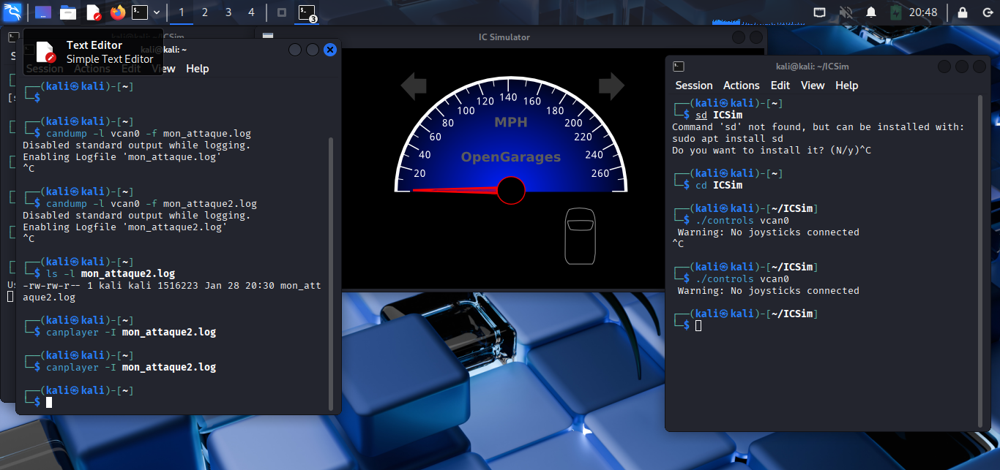

# 📻 CAN Bus Replay Attack


## 🎯 Aperçu du Projet
Ce projet démontre comment intercepter et rejouer des paquets CAN pour contrôler un véhicule sans accès au code source.

## 📸 Preuve de Concept (PoC)
Voici le terminal exécutant l'attaque à côté du tableau de bord ciblé :



## ⚙️ Méthodologie

### 1. Interception (Sniffing)
Utilisation de `candump` pour écouter le bus `vcan0` et capturer le signal d'accélération et de clignotant.

```bash
candump -l vcan0 -f mon_attaque2.log
